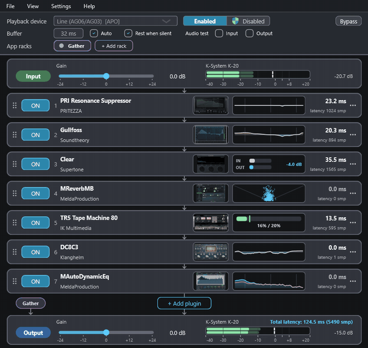

[English](README.md) | 日本語

# PRI System Rack

Windows の再生デバイスに出る音すべてに、VST3 プラグインをかけるアプリです。

YouTube、音楽プレーヤー、ゲーム、通話アプリなど、選んだ再生デバイスから出る音をまとめて処理します。仮想オーディオデバイスも ASIO も使いません。



> [!IMPORTANT]
> **Cubase などの DAW が ASIO で出す音には、エフェクトをかけられません。**
> PRI System Rack が処理できるのは、Windows の音声エンジンを通る音（普通のアプリが出す音）だけです。ASIO や WASAPI の排他モードで出す音は、音声エンジンを通らずにデバイスへ直接届くので、PRI System Rack を通りません。DAW の音にプラグインをかけたいときは、DAW の中でかけてください。

```
各アプリの音 → Windows の音声エンジン（ミックス）→ PRI System Rack で処理 → 再生デバイス（スピーカー・ヘッドホン）
```

音声エンジンに差し込んだ部品（APO）が、ミックスされた音を PRI System Rack のアプリに渡し、VST3 プラグインで処理した音を受け取って再生デバイスに送ります。

## 特長

- **再生デバイスの音全体に VST3 プラグイン**: Windows の音声処理の部品（APO）として再生デバイスに入り、ミックスされたあとの音をアプリに渡して処理します。
- **プラグインの画面がそのまま動く**: プラグインは普通のデスクトップアプリの中で動くので、アナライザーやメーターもリアルタイムに動きます。
- **縦に並べるラック**: 入力（ゲイン・メーター）→ プラグイン（上から順に処理）→ 出力（ゲイン・メーター）。ドラッグで並べ替え、ON/OFF、複製、置き換えができます。
- **アプリ用ラック**: 指定したアプリ（例: 通話アプリ）の音だけを取り込んで別のプラグインで処理し、再生デバイスの音に合流させます。
- **プリセット**: ラックの構成をまるごと名前を付けて保存し、すぐ切り替えられます。
- **重いプラグインへの備え**: 処理バッファ（先読み）で、ときどき処理が重くなるプラグインでも音が途切れにくくします。量は自動でも決められます。
- **落ちにくい作り**:
  - プラグインが音の処理の中でエラーを起こしたときは、多くの場合そのプラグインだけを止めて、アプリと音は続けます。
  - プラグインの画面の中でエラーが起きたときは、多くの場合その画面だけを閉じて、アプリと音は続けます。
  - アプリが落ちても、APO が音をそのまま通すので、音は止まりません（その間はプラグインを通らない音になります）。
  - 前回正しく終わらなかったときは、すべてのプラグインを OFF にして起動する「セーフモード」を選べます。
- **出力の保護**: 0 dBFS を超える音（音割れ）や不正な値（NaN など）をスピーカーに出さないリミッター（既定で ON）。
- **通知領域に常駐**: 状態をアイコンの色で表示します。入出力のレベルメーターにもできます。
- **メーター**: 入力・出力にピーク、RMS、VU、ラウドネス（LUFS）、K-System。プラグインごとに、増減・スペクトル・位相相関・ゴニオメーター・処理の重さなど（「5. メーター」）。
- 画面は日本語と英語に対応しています。

## 動作環境

- Windows 10（64 ビット）。Windows 10 22H2 で確認しています。Windows 11 での動作はまだ確認していません。
  - アプリ用ラックには、Windows 10 バージョン 2004 以降が必要です。
- 64 ビット（x64）の VST3 プラグイン。VST2（`.dll`）と 32 ビットのプラグインには対応していません。
- 管理者の権限（インストールと、再生デバイスで［有効］・［無効］を切り替えるとき）

## インストール

1. [Releases](../../releases) から `PRISystemRack-Setup-<版>.exe` をダウンロードして実行します。
   - インストーラーにはコード署名がないので、「Windows によって PC が保護されました」と出ることがあります。「詳細情報」→「実行」で進めてください。
2. PRI System Rack は `C:\Program Files\PRISystemRack` にインストールされます（場所は変えられません）。スタートメニューに「PRI System Rack」ができます（デスクトップのショートカットは、選んだときだけ作ります）。

インストーラーは、Windows が署名のない音声の部品（APO）を読み込めるように設定します（`DisableProtectedAudioDG`）。

- この設定は、Windows の音声エンジンの保護を弱めるものです。Microsoft の文書では開発・テスト用の設定とされていて、保護されたコンテンツ（著作権保護のかかった動画など）の再生に失敗することがあると報告されています（詳しくは [docs/WindowsAPO.ja.md](docs/WindowsAPO.ja.md#署名と保護された環境)）。
- ほかの音声ツールが使っていることがあるため、アンインストールしても戻しません。

### 更新

新しい版のインストーラーを実行するだけです。

- 動いている PRI System Rack は、インストーラーが自動で終了させます。
- 設定・プリセットと、［有効］にしていた再生デバイスは、そのまま残ります。
- 音声の部品（APO）が変わる更新のときだけ、Windows の音が数秒止まります。

## 使い方

### 1. 再生デバイスで有効にする

1. 「再生デバイス」で、音を処理したいデバイス（スピーカーやヘッドホン）を選びます。
2. 右の［有効］を押します。管理者の確認（UAC）が出たら許可してください。Windows Audio（Windows の音声サービス）が再起動するので、数秒音が止まります。
3. デバイス名の後ろに［APO］が付き、ステータスバーが「APO と接続済み。このデバイスで音が再生されると処理を始めます」になります。何か音を再生して「APO で処理中」になれば動いています。

- 一度に処理できる再生デバイスは 1 つです。別のデバイスに切り替えるときは、先に［無効］を押してください。
- ［有効］にすると、PRI System Rack は、そのデバイスに入っていたほかの APO を控えてから外します。ほかの APO には、Equalizer APO などのイコライザーソフトのほかに、メーカーのドライバーが入れたスピーカーの補正や音響効果も含みます。
  - ［有効］の間はそれらの効果がかからないので、ノート PC の内蔵スピーカーなどでは音の感じが変わることがあります。
  - ［無効］を押すと元に戻ります。
  - 一覧では、ほかの APO が入っているデバイスの名前の後ろに［他の APO］と出ます。
- ［有効］にした直後の最初の再生だけ、アプリによっては鳴らないことがあります。いったん止めて、もう一度再生してください。
- オーディオインターフェイスによっては、サンプルレートが変わると Windows からは別のデバイスとして見えます（ASIO を使う DAW がレートを変えたときなど）。PRI System Rack は同じ出力の新しいデバイスに自動で移りますが、そのレートで初めて使うときは、もう一度［有効］を押すよう案内が出ます。

### 2. プラグインを足す

- ［＋ プラグインを追加］で、VST3 フォルダー（既定は `C:\Program Files\Common Files\VST3`）にあるプラグインの一覧から選びます。
  - 名前・メーカー・種類で絞り込めます。
  - 探すフォルダーは［VST3 フォルダー...］で追加できます。
- エクスプローラーから `.vst3` をラックにドロップしても足せます。
- 行をダブルクリックすると、プラグインの画面を開きます。行の右端の ⋯（または右クリック）で、複製・置き換え・削除などができます。
- 行の名前の右には、プラグインの画面の縮小が出ます。画面を開いている間に自動で撮って（開いた直後と、5 秒ごと、閉じる直前）、保存します（プリセットにも入るので、起動し直しても出ます）。まだ一度も画面を開いていなければ「画面なし」と出ます。縮小をクリックしても画面を開けます。
- 上から順に処理されます。行をドラッグして並べ替えられます。

### 3. 聴き比べる

- ［バイパス］で、メインのラックのプラグインを通さない音と聴き比べられます（ゲインはかかります）。アプリ用ラックは、それぞれのウィンドウの［バイパス］か、メイン画面のラックの名前の札の丸をクリックして切り替えます。
- 「音声テスト」で 440 Hz のテスト音を鳴らせます。プラグインを通る音（入力）と通らない音（出力）を選べます。

### 4. プリセット

- ファイルメニューの「新規保存...」で、ラックの構成（プラグインの並びと設定、ゲイン、アプリ用ラック）に名前を付けて保存します。変更を同じプリセットに保存するときは「上書き保存」です。
- 「プリセットを開く」（通知領域のアイコンの右クリックからも選べます）で切り替えます。
- プリセットを開くと、確認なしですぐ切り替わります。残したい変更は、先に「上書き保存」してください。

### 5. メーター

メーターは 2 か所にあり、それぞれ種類を選べます。

**入力・出力の欄のメーター**

メーターの上でマウスホイールを回すと順に切り替わり、右クリックすると一覧から選べます。表示メニューの「入出力のメーター」からも選べます。種類はすべての入力・出力の欄（アプリ用ラックも含む）で共通です。

| 種類 | 内容 |
| --- | --- |
| ピーク | 瞬間の最大値（-60〜0 dBFS） |
| RMS | 直近 300 ms の平均の大きさ |
| ピーク＋RMS | RMS のバーの後ろに、ピークを薄く重ねる（既定） |
| VU | VU メーター（-18 dBFS = 0 VU） |
| ラウドネス: モーメンタリー / ショートターム / インテグレーテッド（LUFS） | ITU-R BS.1770 のラウドネス（400 ms / 3 秒 / 計り始めてからの全体）。インテグレーテッドは、メーターのクリックか右クリックのメニューで計り直せます |
| K-System K-20 / K-14 / K-12 | 0 を -20 / -14 / -12 dBFS に置いた RMS のメーター |
| 表示しない | メーターを出さない（ホイールや右クリックで戻せます） |

右クリックのメニューか、表示メニューの「入出力のメーター」で、ピークホールド（最大の位置に縦線を少しの間残す）を切り替えられます。

**プラグインの行のメーター**

プラグインの名前の右に、そのプラグインが音をどう変えているかを出します。プラグインごとに選べます。メーターの上でマウスホイールを回すと順に切り替わり、メーターの右クリックか、行の ⋯ メニューの「メーター」から一覧で選べます。新しく足したプラグインに最初に出す種類は、表示メニューの「既定のプラグインメーター」で選びます。

| 種類 | 内容 |
| --- | --- |
| 増減バー | プラグインが音を大きくしたか小さくしたか（出力と入力の差。±12 dB） |
| 入力と出力のレベル | 入力と出力の大きさを 2 本のバーで（既定） |
| 増減の履歴 | 増減の直近 4 秒の動き |
| 周波数ごとの増減 | どの周波数をどれだけ削ったか・足したか（40 Hz〜18 kHz） |
| 出力のスペクトル | 出力の周波数ごとの強さ（入力を薄い線で重ねる） |
| 位相相関 | 出力の左右の相関（+1 は左右が同じ、0 は無関係、マイナスは逆相） |
| ゴニオメーター | 出力の左右の広がりを点で描く |
| 処理の重さ（CPU） | そのプラグインの処理にかかった時間の割合 |
| 表示しない | メーターを出さない（ホイールや右クリックで戻せます） |

メーターを 1 秒に何回描き直すかは、表示メニューの「メーターの fps」で選べます（既定は 20）。

### 6. 処理バッファと無音時の休止

どちらも、メイン画面の上の欄の「バッファ」の行で設定します。すべてのラック（アプリ用ラックも含む）に共通です。

**処理バッファ（「バッファ」）**

プラグインを別のスレッドで先に処理しておき、ときどき処理が重くなるプラグインでも音が途切れないようにする機能です。

- 0〜200 ms で選びます。0 ms でオフです（既定はオフ）。
- 選んだ時間だけ音が遅れます（出力の欄の「最終的なレイテンシー」にも足されます）。動画の音ずれが気になる場合は小さくしてください。
- 「自動」を ON にすると、音が途切れたらその分だけ増やし、30 秒のあいだ余裕があれば少しずつ減らします（2〜200 ms の間）。最初の 1〜2 回の途切れは防げません。
- 間に合わなかった回数は、ステータスバーに「バッファ不足」として出ます。

**無音時に休止（「無音時に休止」。既定は OFF）**

入力も出力も無音が続いたプラグインの処理を止めて、CPU を使わないようにする機能です。音が来るとすぐ処理に戻ります。

- 休止しているプラグインは、［ON］の表示が「休止」に変わります。
- リバーブやディレイの余韻は、プラグインが報告する長さ＋2 秒は待つので切れません。
- 無音から音を出すプラグイン（ノイズを足すものなど）は、行の ⋯ メニューの「常に処理する（無音時も休止しない）」で休止しないようにしてください。
- 休止している間は、プラグインの画面のアナライザーなどの表示も止まります。

### アプリ用ラック（必要な人だけ）

特定のアプリの音にだけ、エフェクトをかけるための機能です。元の音を、聞こえない出力先に回せるアプリが対象です。出力先は、アプリの設定のほか、Windows の「設定」→「システム」→「サウンド」の「サウンドの詳細オプション」にある「アプリの音量とデバイスの設定」でも変えられます。

**使い道の例**: Gather などのオンライン会議・バーチャルオフィスのアプリで、相手の声にだけ次のようなエフェクトをかけます。YouTube や音楽などのほかの音には、かかりません。

- ノイズ削除（相手の環境音やエアコンの音を消す）
- ディエッサー（耳に刺さる「サ行」を抑える）
- 音量の自動調整（人によって違う声の大きさをそろえる）

**しくみ**: 対象のアプリの音だけを取り込み、アプリ用ラックのプラグインで処理してから、メインの再生デバイスの音に合流させます。対象のアプリの出力先を聞こえないデバイスにしておくことで、処理した音だけが聞こえるようにします。

- 合流するのは、メインのラックのプラグインのあと（出力ゲインの手前）です。メインのラックのプラグインはかかりません（出力ゲインと出力の保護はかかります）。

**設定の例（Gather の場合）**:

1. メインの再生デバイス（普段使うスピーカーやヘッドホン）で［有効］にしておきます（「1. 再生デバイスで有効にする」）。アプリ用ラックの音は、メインの再生デバイスの処理に合流するためです。
2. 設定メニューの「アプリ用ラックを使う」を ON にします。
3. ［＋ ラックを追加］を押すと、ラックができて、そのウィンドウが開きます。「アプリを選ぶ...」で `Gather.exe` を選びます（起動していないアプリも、名前で登録できます）。
   - メイン画面の上の欄に、ラックの名前の札が並びます。ウィンドウを閉じたあとは、札をダブルクリックすると開きます。
4. ラックのウィンドウの［＋ プラグインを追加］で、ノイズ削除・ディエッサー・音量の自動調整などのプラグインを足します。
5. Gather の設定で、音声の出力先（スピーカー）を、普段は聞かないデバイスに変えます。例えば、使っていない出力（モニターの HDMI など）や仮想オーディオケーブル（VB-CABLE の「CABLE Input」など）です。

これで、Gather の相手の声はアプリ用ラックで処理されてから、普段のスピーカーやヘッドホンで聞こえます。

- 5 を忘れて、対象のアプリがメインの再生デバイスに直接音を出していると、元の音と処理した音が二重に聞こえます。このときはラックのウィンドウに警告が出て、メイン画面の札の丸がオレンジになります。
- アプリの音量やミュートは、取り込む音にもかかります。対象のアプリをミュートすると、処理した音も聞こえなくなります。元の音を消すには、5 の出力先の変更を使ってください。
- アプリ用ラックは 10 個まで作れます。アプリごとに別のプラグインをかけられます。

### 通知領域

- ウィンドウの × は終了せずに通知領域にしまいます（音の処理は続きます）。終了は、ファイルメニューの「終了」か、通知領域のアイコンの右クリックから行います。
  - 設定メニューの「閉じるボタンで通知領域にしまう」を OFF にすると、× で終了します。
- 処理中は普段のアイコンです。状態によって色が変わります。
  - 黄: バイパス中、または待機中（デバイスが接続されていない・APO を待っている）
  - 赤: 処理が間に合っていない（時間切れ・バッファ不足）、またはエラーで止まったプラグインがある
- 設定メニューの「通知領域のアイコン」→「メーターと状態」にすると、アイコンが入力と出力のレベルメーターになります（既定は「静止画」）。
- 設定メニューの「Windows の起動時に起動する」で、ログオン時に通知領域だけで起動します。

## 注意点と制限

- PRI System Rack が起動していない間は、APO は音をそのまま通します（プラグインはかかりません）。
- プラグインの数とバッファの分だけ、音が遅れます。出力の欄に出る最終的なレイテンシーは PRI System Rack の中の遅れで、Windows とデバイスのバッファの遅れは含みません。
- ASIO や WASAPI の排他モードで出す音（Cubase などの DAW、一部の音楽プレーヤーの「排他モード」など）は通りません（冒頭の注意を見てください）。
- リモート デスクトップの「リモート オーディオ」には入れられません（一覧に「使えません」と出ます）。リモート デスクトップ中も PC 側で処理したいときは、接続の設定で「リモート オーディオ」を「リモート コンピューターで再生する」にしてください。
- プラグインを足すときは、「プラグイン安全チェック」（設定メニュー。既定で ON）が、先に別のプロセスでそのプラグインを試します。次のようなプラグインは読み込みません。
  - 作る・準備する・音を処理する・設定を保存して戻すのどこかで落ちる、または時間内に終わらない
  - Windows の描画資源を使い切る
  - 64 ビット用でない、Visual C++ ランタイムが足りない、Windows が読み込めない

  試している間は進み具合のダイアログが出て、［やめる］で取りやめられます。読み込めないと分かったプラグインは、プラグインの一覧に「読み込めません」の印と理由を出します。一覧で選ぶか、ラックの行の ⋯ メニューの「プラグインを更新（読み込み直す）」で、もう一度チェックできます。

  - 64 ビット用でないプラグインと、描画資源を使い切るプラグインは、アプリを起動し直しても覚えています（プラグインのファイルが新しくなったら、もう一度チェックします）。
  - それ以外の理由（落ちる、時間内に終わらないなど）は、PC の状態で変わることがあるので、アプリを起動している間だけ覚えます。

## 困ったとき

- **プラグインが一覧に出ない**:
  - 一覧の上に「n 個のファイルは調べられませんでした」と出ていたら、クリックすると理由が出ます。理由に「Visual C++ ランタイム」が古い・入っていないと出たら、Microsoft の [Visual C++ 再頒布可能パッケージ（x64）](https://aka.ms/vs/17/release/vc_redist.x64.exe) を入れてから、［一覧を作り直す］を押してください。
  - インストゥルメント（シンセやサンプラー）は、「エフェクトのみ」（既定で ON）で一覧から隠れています。このアプリには MIDI の入力がないので、音は出ません。
  - VST2（`.dll`）と 32 ビットのプラグインには対応していません。
- **プラグインのせいで起動しない・落ちる**: 次の起動で「すべてのプラグインを OFF にして起動しますか」と聞かれたら「はい」を選び、1 つずつ ON に戻して原因を探してください。
- **音が途切れる**: メイン画面のステータスバーの上に赤い帯が出て、処理の負荷と重いプラグインが出ます。「バッファ」を増やすか「自動」にしてください。負荷が 100% を超えているときは、ON のプラグインを減らすか、PC のほかの重い処理を止めてください。
- **ログと不具合の報告**:
  - ログはヘルプメニューの「ログフォルダーを開く」で開きます（`C:\ProgramData\PRISystemRack\Logs`）。
  - 不具合は [Issues](../../issues) に報告してください。`app.log`（`app-<ユーザー名>.log` のこともあります）、`apo.log`、`setup.log` と、落ちたときは `%APPDATA%\PRISystemRack\Crashes` の新しい `crash-*.txt` を添えてください。
  - ログには、デバイス名や Windows のユーザー名が入ることがあります。公開の場に貼る前に、中身を確かめてください。

## アンインストール

Windows の「アプリと機能」から「PRI System Rack」をアンインストールします。

- 有効にしていた再生デバイスは、元の状態（入っていた APO を含む）に戻ります。Windows Audio が再起動するので、数秒音が止まります。
- 最後に、設定・プリセット・ログも削除するかを聞きます（既定は残します）。

## ファイルの場所

| 内容 | 場所 |
| --- | --- |
| 本体 | `C:\Program Files\PRISystemRack` |
| 設定・プリセット・プラグインの一覧 | `%APPDATA%\PRISystemRack` |
| 落ちたときの記録 | `%APPDATA%\PRISystemRack\Crashes`（新しい 10 件） |
| ログ | `C:\ProgramData\PRISystemRack\Logs` |

## ソースからビルドする

必要なもの:

- Visual Studio 2026（C++ によるデスクトップ開発）
- Windows SDK 10.0.26100 以降
- CMake 3.25 以降
- JUCE 8.0.16（`external/JUCE` に置く）

```powershell
git clone --depth 1 --branch 8.0.16-security https://github.com/juce-framework/JUCE.git external/JUCE
cmake -S . -B build -G "Visual Studio 18 2026" -A x64
cmake --build build --config Release
```

CMake の構成のときに、JUCE に小さな修正を 1 つ自動で当てます（プラグインに MIDI の CC の割り当てを問い合わせない。このアプリはプラグインに MIDI を送らないので使わない情報で、古い Waves のプラグインが問い合わせのたびに描画資源を使い続けるのを防ぐため。詳しくは開発メモ）。

インストーラーは [Inno Setup 6](https://jrsoftware.org/isinfo.php) で作ります。

```powershell
.\Tools\Scripts\build-installer.ps1   # dist\PRISystemRack-Setup-<版>.exe
```

APO の仕組みは [docs/WindowsAPO.ja.md](docs/WindowsAPO.ja.md)、作りの詳細・確かめた結果・確認用のツールは [docs/DEVELOPMENT.ja.md](docs/DEVELOPMENT.ja.md)（開発メモ）を見てください。

## ライセンス

Copyright (C) 2026 PRITEZZA

PRI System Rack は [GNU Affero General Public License v3.0](LICENSE)（AGPLv3）で公開しています。改変したものを配布する場合も、同じ AGPLv3 でソースを公開する必要があります。

このソフトウェアは無保証です（AGPLv3 の第 15 条・第 16 条）。Windows の音声の設定やレジストリを変更するので、自分の責任で使ってください。

PRI System Rack は [JUCE](https://juce.com/)（AGPLv3 と商用のデュアルライセンス。ここでは AGPLv3 の条件で使用）を使っています。

VST は Steinberg Media Technologies GmbH の商標です。

## 作者

[github.com/pritezza](https://github.com/pritezza)
