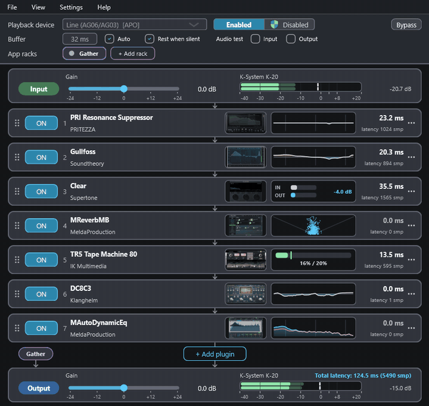

English | [日本語](README.ja.md)

# PRI System Rack

PRI System Rack applies VST3 plugins to everything played on a Windows playback device.

It processes the combined sound that goes to the playback device you choose, such as YouTube, music players, games, and voice chat apps. It does not use a virtual audio device or ASIO.



> [!IMPORTANT]
> **PRI System Rack cannot apply effects to audio that a DAW such as Cubase plays through ASIO.**
> PRI System Rack can process only audio that goes through the Windows audio engine (audio from ordinary apps). Audio played through ASIO or WASAPI exclusive mode bypasses the audio engine and goes straight to the device, so it does not pass through PRI System Rack. To use plugins on your DAW's audio, use them inside the DAW.

```
App audio → Windows audio engine (mix) → processed by PRI System Rack → playback device (speakers, headphones)
```

A component plugged into the audio engine (an APO) passes the mixed audio to the PRI System Rack app, receives the audio processed by the VST3 plugins, and sends it on to the playback device.

## Features

- **VST3 plugins on everything a playback device plays**: Installs into the playback device as a Windows audio processing component (APO) and passes the mixed audio to the app for processing.
- **Plugin editors work as usual**: Plugins run inside an ordinary desktop app, so analyzers and meters update in real time.
- **A vertical rack**: Input (gain, meter) → plugins (processed from top to bottom) → output (gain, meter). Reorder by dragging, and turn on/off, duplicate, or replace plugins.
- **App racks**: Capture only the audio of a chosen app (for example, a voice chat app), process it with separate plugins, and merge it into the playback device's audio.
- **Presets**: Save the whole rack setup under a name and switch instantly.
- **Help for heavy plugins**: A processing buffer (look-ahead) keeps the audio from dropping out with plugins that occasionally take longer to process. The amount can be set automatically.
- **Built to keep running**:
  - When a plugin causes an error while processing audio, in most cases only that plugin is stopped, and the app and the audio keep going.
  - When an error occurs in a plugin's editor, in most cases only that editor is closed, and the app and the audio keep going.
  - Even if the app crashes, the APO passes the audio through, so the sound does not stop (the audio is not processed by the plugins meanwhile).
  - If the app did not exit normally last time, you can start in safe mode with all plugins turned off.
- **Output protection**: A limiter that keeps audio above 0 dBFS (clipping) and invalid values (such as NaN) from reaching your speakers (on by default).
- **Lives in the notification area**: The icon color shows the status. It can also show input and output level meters.
- **Meters**: Peak, RMS, VU, loudness (LUFS), and K-System for input and output. For each plugin: gain change, spectrum, phase correlation, goniometer, processing load, and more (see "5. Meters").
- The UI is available in English and Japanese.

## Requirements

- Windows 10 (64-bit). Tested on Windows 10 22H2. Windows 11 has not been tested yet.
  - App racks require Windows 10 version 2004 or later.
- 64-bit (x64) VST3 plugins. VST2 (`.dll`) and 32-bit plugins are not supported.
- Administrator rights (to install, and to switch a playback device between Enabled and Disabled)

## Installation

1. Download `PRISystemRack-Setup-<version>.exe` from [Releases](../../releases) and run it.
   - The installer is not code-signed, so Windows may show "Windows protected your PC". Click "More info" → "Run anyway".
2. PRI System Rack is installed in `C:\Program Files\PRISystemRack` (the location cannot be changed). "PRI System Rack" is added to the Start menu (a desktop shortcut is created only if you choose it).

The installer configures Windows to load unsigned audio components (APOs) (`DisableProtectedAudioDG`).

- This setting weakens the protection of the Windows audio engine. Microsoft documentation treats it as a setting for development and testing, and users have reported that playback of protected content (such as copy-protected video) can fail when it is set (see [docs/WindowsAPO.md](docs/WindowsAPO.md#signing-and-the-protected-environment) for details).
- Because other audio tools may rely on it, it is not reverted when you uninstall.

### Updating

Just run the installer for the new version.

- The installer closes PRI System Rack automatically if it is running.
- Your settings, presets, and the playback device you enabled are kept.
- Windows sound stops for a few seconds only when the update replaces the audio component (APO).

## Usage

### 1. Enable a playback device

1. Under "Playback device", choose the device whose sound you want to process (speakers or headphones).
2. Click [Enabled] to the right. If User Account Control (UAC) asks for permission, allow it. Windows Audio (the Windows audio service) restarts, so the sound stops for a few seconds.
3. "[APO]" appears after the device name, and the status bar shows "Connected to the APO. Processing starts when audio plays on this device". Play something, and when it shows "Processing via APO", it is working.

- Only one playback device can be processed at a time. To switch to another device, click [Disabled] first.
- When you enable a device, PRI System Rack saves and removes any other APOs on that device. These include equalizer software such as Equalizer APO, and also speaker correction and sound effects installed by the manufacturer's driver.
  - While the device is enabled, those effects are not applied, so the sound may change, for example on a laptop's built-in speakers.
  - Clicking [Disabled] restores them.
  - In the list, devices that have another APO show "[Other APO]" after their name.
- Right after enabling, the first playback in some apps may not sound. Stop it and play again.
- Some audio interfaces appear to Windows as a different device for each sample rate (for example, when a DAW using ASIO changes the rate). PRI System Rack moves to the new device for the same output automatically, but the first time a rate is used, it asks you to click [Enabled] again.

### 2. Add plugins

- Click [+ Add plugin] and choose from the list of plugins in your VST3 folders (by default, `C:\Program Files\Common Files\VST3`).
  - You can filter by name, manufacturer, or category.
  - Add folders to search with [VST3 folders...].
- You can also drop `.vst3` files from Explorer onto the rack.
- Double-click a row to open the plugin editor. The ⋯ button at the right end of a row (or a right-click) lets you duplicate, replace, or remove the plugin, and more.
- To the right of the plugin's name, each row shows a thumbnail of the plugin's editor. It is captured automatically while the editor is open (right after opening, every 5 seconds, and just before closing) and saved, including in presets, so it is still shown after restarting the app. If the editor has never been opened, the row shows "No snapshot". Clicking the thumbnail also opens the editor.
- Plugins are processed from top to bottom. Drag rows to reorder them.

### 3. Compare

- [Bypass] lets you compare with the sound without the main rack's plugins (gain is still applied). For app racks, use the [Bypass] in each rack's window, or click the dot on the rack's name tag in the main window.
- "Audio test" plays a 440 Hz test tone. You can choose to send it through the plugins (Input) or not (Output).

### 4. Presets

- Use "Save as new preset..." in the File menu to save the rack setup (the plugins in order and their settings, gains, and app racks) under a name. To save changes to the same preset, use "Overwrite save".
- Switch presets with "Open preset" (also available from the right-click menu of the notification area icon).
- Opening a preset switches immediately without asking. Use "Overwrite save" first if you want to keep your changes.

### 5. Meters

There are meters in two places, and you can choose the type for each.

**Input and output section meters**

Scroll the mouse wheel over a meter to step through the types, or right-click it to choose from a list. You can also choose under "Input/output meter" in the View menu. The type is shared by all input and output sections (including app racks).

| Type | What it shows |
| --- | --- |
| Peak | Instantaneous peak level (-60 to 0 dBFS) |
| RMS | Average level over the last 300 ms |
| Peak + RMS | An RMS bar with the peak shown faintly behind it (default) |
| VU | A VU meter (-18 dBFS = 0 VU) |
| Loudness: momentary / short-term / integrated (LUFS) | ITU-R BS.1770 loudness (400 ms / 3 s / everything since measuring started). To restart the integrated measurement, click the meter or use its right-click menu |
| K-System K-20 / K-14 / K-12 | An RMS meter with 0 placed at -20 / -14 / -12 dBFS |
| None | Hides the meter (bring it back with the mouse wheel or a right-click) |

Peak hold (a line that briefly stays at the highest point) can be turned on or off from the right-click menu or under "Input/output meter" in the View menu.

**Plugin row meters**

To the right of each plugin's name, a meter shows how the plugin changes the sound. You can choose the type for each plugin. Scroll the mouse wheel over the meter to step through the types, or choose from a list by right-clicking the meter or using "Meter" in the row's ⋯ menu. The type used for newly added plugins is set with "Default plugin meter" in the View menu.

| Type | What it shows |
| --- | --- |
| Gain change bar | Whether the plugin made the sound louder or quieter (output minus input, ±12 dB) |
| Input and output levels | Input and output levels as two bars (default) |
| Gain change history | The gain change over the last 4 seconds |
| Gain change by frequency | Which frequencies the plugin cut or boosted, and by how much (40 Hz to 18 kHz) |
| Output spectrum | The output level at each frequency, with the input shown as a faint line |
| Phase correlation | Correlation between the output's left and right channels (+1: identical, 0: unrelated, negative: out of phase) |
| Goniometer | The stereo spread of the output, drawn as dots |
| Processing load (CPU) | The share of time the plugin takes to process the audio |
| None | Hides the meter (bring it back with the mouse wheel or a right-click) |

"Meter fps" in the View menu sets how many times per second the meters are redrawn (20 by default).

### 6. Processing buffer and resting when silent

Both are set in the "Buffer" row at the top of the main window. They apply to all racks (including app racks).

**Processing buffer ("Buffer")**

Plugins are processed ahead of time on a separate thread, so the audio does not drop out with plugins that occasionally take longer to process.

- Choose from 0 to 200 ms. 0 ms turns it off (off by default).
- The audio is delayed by the time you choose (it is also added to the "Total latency" in the output section). If the delay bothers you, for example with video, make it smaller.
- With "Auto" on, the buffer grows by the amount needed when the audio drops out, and shrinks a little at a time when there has been headroom for 30 seconds (between 2 and 200 ms). It cannot prevent the first one or two dropouts.
- The number of times processing did not keep up is shown in the status bar as "Buffer underruns".

**Rest when silent ("Rest when silent", off by default)**

Plugins whose input and output have both been silent for a while stop processing, so they do not use the CPU. They resume as soon as sound arrives.

- A resting plugin's [ON] button changes to "Resting".
- Reverb and delay tails are not cut off: the app waits for the tail length the plugin reports plus 2 seconds.
- For plugins that make sound from silence (such as ones that add noise), turn on "Always process (do not rest when silent)" in the row's ⋯ menu.
- While a plugin is resting, displays such as analyzers in its editor also stop.

### App racks (optional)

This feature applies effects to the audio of specific apps only. It works with apps whose original audio you can send to an output you do not listen to. Besides the app's own settings, you can change an app's output device in Windows under "Settings" → "System" → "Sound" → "Advanced sound options" → "App volume and device preferences".

**Example uses**: In an online meeting or virtual office app such as Gather, apply effects like the following only to the other people's voices. Other sounds, such as YouTube or music, are not affected.

- Noise removal (removes background noise and air conditioner hum from the other people's audio)
- De-esser (tames harsh "s" sounds)
- Automatic level control (evens out voices that differ in loudness)

**How it works**: It captures only the target app's audio, processes it with the app rack's plugins, and merges it into the main playback device's audio. By sending the target app's output to a device you do not listen to, you hear only the processed audio.

- The audio is merged after the main rack's plugins (before the output gain). The main rack's plugins are not applied to it (the output gain and output protection are).

**Example setup (Gather)**:

1. Enable your main playback device (the speakers or headphones you normally use) as described in "1. Enable a playback device". App rack audio is merged into the main playback device's processing.
2. Turn on "Use app racks" in the Settings menu.
3. Click [+ Add rack]. A rack is created and its window opens. Use "Choose apps..." to select `Gather.exe` (you can also register an app by name when it is not running).
   - Name tags for the racks appear in the top area of the main window. After closing a rack's window, double-click its name tag to open it again.
4. In the rack's window, use [+ Add plugin] to add plugins such as noise removal, a de-esser, or automatic level control.
5. In Gather's settings, change the audio output (speaker) to a device you do not normally listen to, such as an unused output (for example, a monitor's HDMI audio) or a virtual audio cable (for example, "CABLE Input" from VB-CABLE).

Now the other people's voices in Gather are processed by the app rack and then heard through your usual speakers or headphones.

- If you skip step 5 and the target app plays directly to the main playback device, you hear both the original and the processed audio. In that case, the rack's window shows a warning and the dot on the rack's name tag in the main window turns orange.
- The app's volume and mute also apply to the captured audio. If you mute the target app, you will not hear the processed audio either. To silence the original audio, change the output device as in step 5.
- You can create up to 10 app racks, each with its own plugins for different apps.

### Notification area

- Closing the window with × does not exit the app; it hides it in the notification area (audio processing continues). To exit, use "Exit" in the File menu or right-click the notification area icon.
  - If you turn off "Close to the notification area" in the Settings menu, × exits the app.
- While processing, the icon looks normal. Its color changes with the status:
  - Yellow: bypassed, or waiting (the device is not connected, or waiting for the APO)
  - Red: processing cannot keep up (timeouts or buffer underruns), or a plugin was stopped by an error
- Choose "Notification area icon" → "Meters and status" in the Settings menu to turn the icon into input and output level meters (the default is "Still icon").
- "Start with Windows" in the Settings menu starts the app in the notification area when you sign in.

## Notes and limitations

- While PRI System Rack is not running, the APO passes the audio through (plugins are not applied).
- Plugins and the buffer delay the audio. The total latency shown in the output section is the delay inside PRI System Rack and does not include Windows' and the device's buffers.
- Audio played through ASIO or WASAPI exclusive mode (DAWs such as Cubase, or the "exclusive mode" of some music players) does not pass through (see the note at the top).
- It cannot be installed on the "Remote Audio" device of a Remote Desktop session (the list shows "Not supported"). To keep processing on the PC during Remote Desktop, set "Remote audio" in the connection settings to "Play on remote computer".
- When you add a plugin, "Plugin safety check" (Settings menu, on by default) first tries it in a separate process. It does not load plugins that:
  - crash or do not finish in time while being created, prepared, processing audio, or saving and restoring their settings
  - use up Windows' drawing resources
  - are not 64-bit, lack the Visual C++ runtime they need, or cannot be loaded by Windows

  A progress dialog is shown during the check, and you can stop it with [Cancel]. Plugins found to be unloadable are marked "Cannot load" in the plugin list with the reason. To check one again, select it in the list, or use "Reload plugin" in the ⋯ menu of its row in the rack.

  - Plugins that are not 64-bit or that use up drawing resources are remembered even after restarting the app (they are checked again when the plugin file is updated).
  - Other results (crashing, not finishing in time, and so on) can change depending on the state of the PC, so they are remembered only while the app is running.

## Troubleshooting

- **A plugin does not appear in the list**:
  - If the top of the list says that some files could not be scanned, click it to see the reasons. If the reason says the Visual C++ runtime is old or not installed, install the Microsoft [Visual C++ Redistributable (x64)](https://aka.ms/vs/17/release/vc_redist.x64.exe), then click [Rebuild list].
  - Instruments (synths and samplers) are hidden by "Effects only" (on by default). This app has no MIDI input, so they would make no sound.
  - VST2 (`.dll`) and 32-bit plugins are not supported.
- **The app does not start or crashes because of a plugin**: When the next start asks whether to start with all plugins turned OFF, choose "Yes", then turn the plugins back on one by one to find the cause.
- **The audio drops out**: A red banner appears above the status bar of the main window, showing the processing load and the heaviest plugins. Increase "Buffer" or turn on "Auto". If the load is over 100%, turn off some plugins or stop other heavy work on the PC.
- **Logs and bug reports**:
  - Open the logs with "Open log folder" in the Help menu (`C:\ProgramData\PRISystemRack\Logs`).
  - Please report bugs in [Issues](../../issues). Attach `app.log` (sometimes `app-<user name>.log`), `apo.log`, and `setup.log`, and if the app crashed, the latest `crash-*.txt` in `%APPDATA%\PRISystemRack\Crashes`.
  - Logs may contain device names and your Windows user name. Check their contents before posting them in public.

## Uninstallation

Uninstall "PRI System Rack" from "Apps & features" in Windows.

- Enabled playback devices are restored to their previous state (including any APOs that were on them). Windows Audio restarts, so the sound stops for a few seconds.
- At the end, you are asked whether to also delete your settings, presets, and logs (by default, they are kept).

## File locations

| Contents | Location |
| --- | --- |
| Program | `C:\Program Files\PRISystemRack` |
| Settings, presets, plugin list | `%APPDATA%\PRISystemRack` |
| Crash records | `%APPDATA%\PRISystemRack\Crashes` (the latest 10) |
| Logs | `C:\ProgramData\PRISystemRack\Logs` |

## Building from source

Requirements:

- Visual Studio 2026 (Desktop development with C++)
- Windows SDK 10.0.26100 or later
- CMake 3.25 or later
- JUCE 8.0.16 (placed in `external/JUCE`)

```powershell
git clone --depth 1 --branch 8.0.16-security https://github.com/juce-framework/JUCE.git external/JUCE
cmake -S . -B build -G "Visual Studio 18 2026" -A x64
cmake --build build --config Release
```

When CMake configures the project, it automatically applies one small patch to JUCE: plugins are not queried for their MIDI CC assignments. This app never sends MIDI to plugins, so the information is not needed, and some old Waves plugins keep using up Windows drawing resources each time they are queried (see the development notes for details).

The installer is built with [Inno Setup 6](https://jrsoftware.org/isinfo.php).

```powershell
.\Tools\Scripts\build-installer.ps1   # dist\PRISystemRack-Setup-<version>.exe
```

For how APOs work, see [docs/WindowsAPO.md](docs/WindowsAPO.md). Implementation details, test results, and the test tools are described in [docs/DEVELOPMENT.ja.md](docs/DEVELOPMENT.ja.md) (development notes, in Japanese).

## License

Copyright (C) 2026 PRITEZZA

PRI System Rack is released under the [GNU Affero General Public License v3.0](LICENSE) (AGPLv3). If you distribute a modified version, you must also publish its source code under the AGPLv3.

This software comes with no warranty (sections 15 and 16 of the AGPLv3). It changes Windows audio settings and the registry, so use it at your own risk.

PRI System Rack uses [JUCE](https://juce.com/) (dual-licensed under the AGPLv3 and a commercial license; used here under the AGPLv3).

VST is a trademark of Steinberg Media Technologies GmbH.

## Author

[github.com/pritezza](https://github.com/pritezza)
